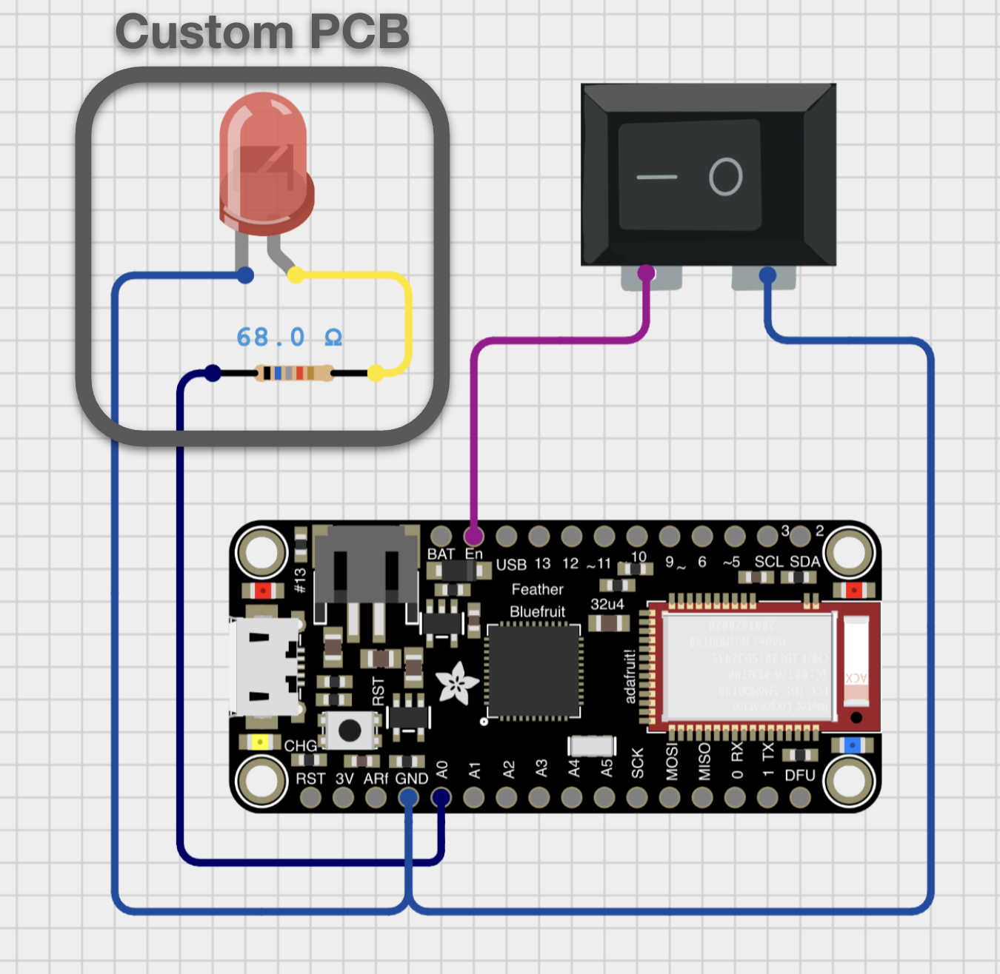

# Beacon Hardware

This directory contains the CAD models and circuit design for the physical Beacon device.

## CAD Models

The source files for the CAD models are released on OnShape [here](https://cad.onshape.com/documents/63ff3395b9d858efbb2304b3/w/c2ced754981f6ef1295a8a90/e/e487c9470a844dd7be8eb912).
The resulting `cad/*.stl` mesh files are in this directory.

## Circuit Design

The LED is mounted on a PCB that sits inside the device's head.
This custom PCB is released as Gerber file in `Gerber_Beacon_Head_PCB.zip`.

## Optical Diffuser

The optical diffuser is a translucent sheet of acrylic laser cut into a circle with a diameter of 25 mm.
Better yet, use the same outline as the PCB outline.

## Bill of Materials

- [Adafruit Feather 32u4 Bluefruit LE](https://learn.adafruit.com/adafruit-feather-32u4-bluefruit-le)
- 10,000 mAh Lithium Polymer Battery
- [Rocker Power Switch](https://www.amazon.com/DaierTek-Listed-Switches-Automotive-KCD1-5Pack/dp/B07S1MV462/ref=sr_1_2)
- [6000K White LED in 1210 SMD Packaging](https://www.amazon.com/AEDIKO-Lighting-Electronics-Components-Emitting/dp/B09XB5KJ41/ref=sr_1_3)
- [68 Ohm Resistor in 0603 SMD Packaging](https://www.digikey.com/en/products/detail/panasonic-industry/ERJ-3GEYJ680V/135644)
- [69% Transmission Lighting White 3 mm (1/8") Acrylic](https://www.tapplastics.com/product/plastics/cut-to-size-plastic/white-lighting-plexiglass)
